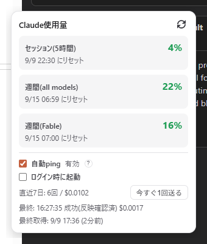
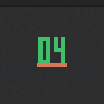
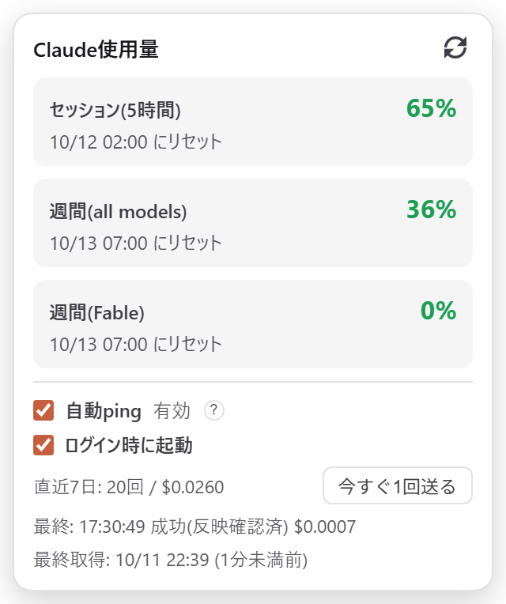
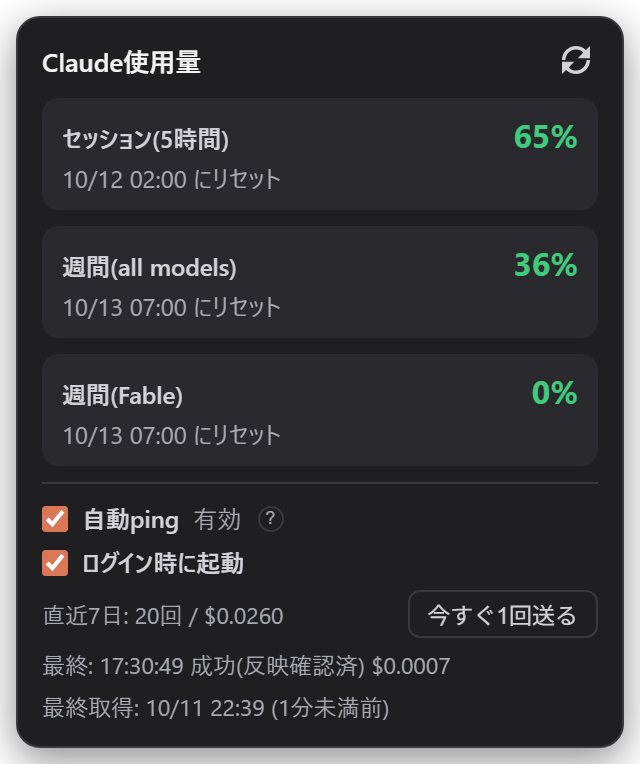
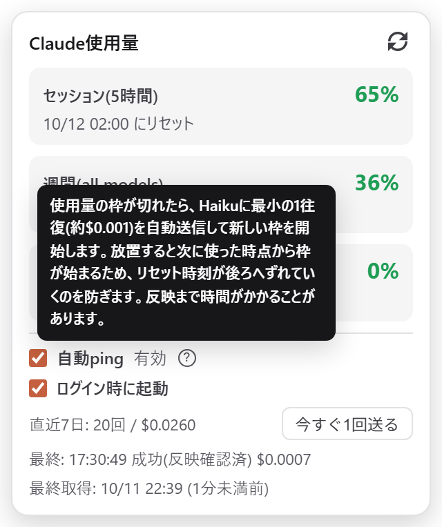
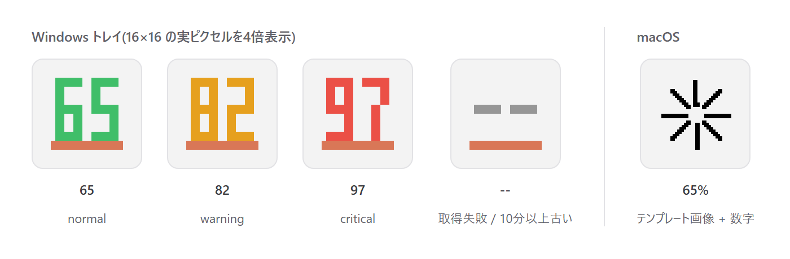
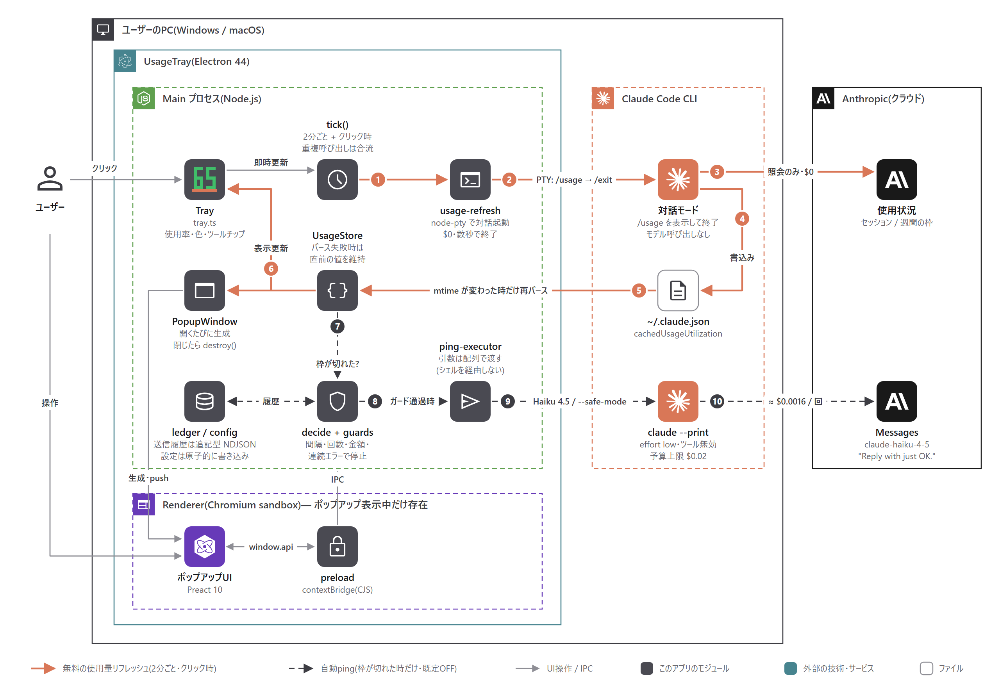
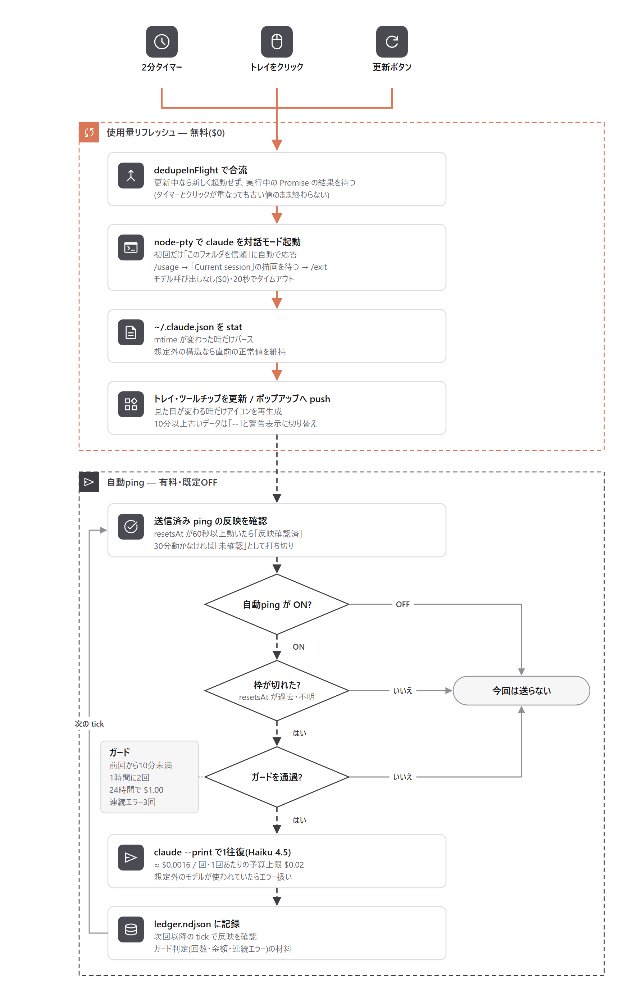
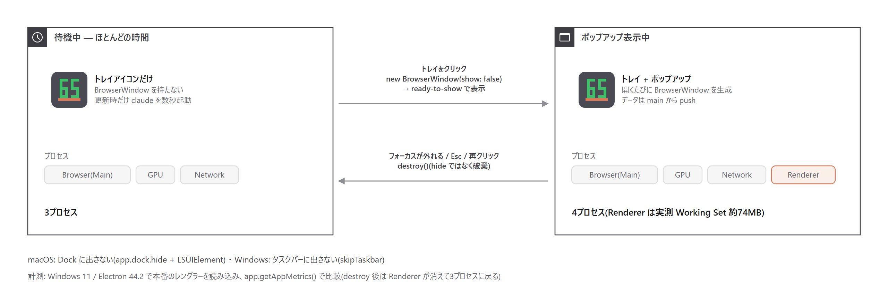
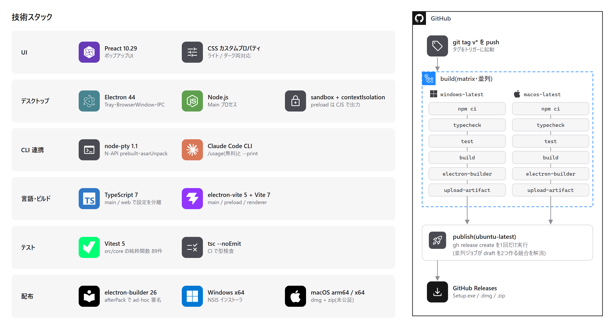

# UsageTray

Claude の使用量制限(5時間のセッション枠・週間枠)を、Windows のタスクトレイ / macOS のメニューバーに常時表示する常駐アプリです。枠が切れたときだけ最小コストの ping を自動で送り、次の枠をすぐに開始させます。

[](https://github.com/terasaki-8910/claude-usage-tray/releases/latest)

[](LICENSE)

<table>
  <tr>
    <td></td>
    <td></td>
  </tr>
  <tr>
    <td>実機(Windows 11)。トレイをクリックするとポップアップが開く</td>
    <td>トレイアイコン。セッション使用率を2桁で常時表示</td>
  </tr>
</table>

## 作った理由

Claude は使い方次第で「どのモデルに何を任せるか」が変わります。枠が逼迫していれば Claude Code を Sonnet に切り替え、余っていれば残りのタスクを並列で回す。その判断には、現在の使用率とリセット時刻がいつでも目に入っていることが必要でした。

もう一つは、リセット時刻がずれていく問題です。5時間のセッション枠は「枠が切れたあと、最初に使った時刻」から始まります。しばらく使わずにいると、次の枠の開始がそのぶん後ろへずれていきます。枠が切れた瞬間に最小限のリクエストを1回送れば、枠を途切れさせずに済みます。

## 機能

<table>
  <tr>
    <td></td>
    <td></td>
    <td></td>
  </tr>
  <tr>
    <td>セッション / 週間(全モデル)/ 週間(Fable)の使用率とリセット時刻</td>
    <td>OS のダークモードに追従</td>
    <td>説明は「?」にホバー・フォーカスしたときだけ表示</td>
  </tr>
</table>



- **常時表示**: Windows は 16×16 のトレイアイコンに使用率を描画し、色は使用量データの severity に従います。データが取得できないときや10分以上古いときは `--` を表示します。macOS はアイコンの横に数字を出します。
- **ほぼリアルタイムの更新**: 2分ごとと、トレイをクリックするたびに更新します。この更新にはモデル呼び出しがなく、費用は $0 です(後述)。
- **自動 ping(既定 OFF)**: 枠が切れたときだけ、Haiku に1往復だけ送って次の枠を開始します。費用は実測で中央値 $0.0016/回です。
- **手動 ping**: 「今すぐ1回送る」で動作確認ができます。安全ガードは手動のときも有効です。
- **ログイン時に起動**: OS のログイン項目に登録します(Windows はレジストリの Run キー、macOS はログイン項目)。

画像のうち `desktop-*.png` は実機のキャプチャ、`popup*.png` と `tray-icons.png` は本番のレンダラーとアイコン描画コードを [`docs/tools/`](docs/tools) から描画したものです(使用量の数値はこのPCの実データ)。

## アーキテクチャ



Claude Code には使用量を返す公開 API がありません。そこで、CLI が自分のために書き出すキャッシュ `~/.claude.json` の `cachedUsageUtilization` を読んでいます。

ただし、このキャッシュは放っておくと更新されません。`claude -p`(非対話モード)をどれだけ実行しても、6.75時間以上まったく変わらないことを確認しました。一方、対話モードで `/usage` を開くとその場で更新されます。そこで **node-pty で疑似端末を割り当てて `claude` を裏で対話起動し、`/usage` を送って `/exit` で抜ける**処理を、2分ごととクリック時に実行しています(①〜⑥)。`/usage` はアカウント状況の照会だけで、画面上の表示は `Total cost: $0.0000` です。この経路にお金はかかりません。

リセット時刻を実際に進めるには、本物のモデル呼び出しが要ります。それを担うのが自動 ping(⑦〜⑩)で、更新経路とは独立しています。

## 処理フロー



- **更新の合流**: 定期実行とクリックが重なっても、`claude` は1つしか起動しません。後から来た呼び出しは、実行中の更新の Promise をそのまま待ちます([`dedupe-in-flight.ts`](src/core/dedupe-in-flight.ts))。以前は真偽値のフラグで二重起動を防いでいたため、後から来た側が何もせずに終わり、「更新ボタンのぐるぐるは止まるのに値が変わらない」不具合になっていました。
- **枠切れの判定**: データの `is_active` は「枠が有効か」ではなく「いま上限を拘束している枠か」を表していました。そのため判定には使わず、`resetsAt` と現在時刻だけで判断しています([`scheduler-logic.ts`](src/core/scheduler-logic.ts))。
- **反映の確認**: ping のあと、`resetsAt` が60秒以上動いたら「反映確認済」とします。キャッシュの揺らぎ(数十ミリ秒)を成功と誤判定しないための閾値です([`ping-confirm.ts`](src/core/ping-confirm.ts))。

## 自動 ping のコスト設計

| 対策 | 効果(実測) |
| --- | --- |
| `--safe-mode` | 付けないと、設定済みの MCP サーバーのツール定義が読み込まれ、1回 $0.086〜$0.134 になる。付けると $0.001 前後(約100分の1) |
| `--system-prompt "."` | Claude Code 既定のシステムプロンプトを置き換える(入力 910 + キャッシュ作成 9,822 トークン → 256 トークン) |
| `--tools ""` / `--strict-mcp-config` / `--no-session-persistence` / `--effort low` | ツール・MCP・セッション保存を無効化 |
| `--max-budget-usd 0.02` | 1回あたりの予算上限 |
| 出力の `modelUsage` を検査 | 指定外のモデルが使われていたらエラーとして扱う |
| 安全ガード | 前回から10分未満 / 1時間に2回 / 24時間で $1.00 / 連続エラー3回 のいずれかに当たれば送信しない |

引数は配列で `spawn` に渡し、シェルは経由しません([`ping-args.ts`](src/core/ping-args.ts))。

実運用(2026-09-08〜09-30)では53回送信しました。成功は49回で、49回すべてについてリセット時刻が実際に進んだことを確認しています。合計費用は $0.0758、1回あたりの中央値は $0.0016 でした。

## メモリ設計



待機中はトレイアイコンだけを持ち、ウィンドウを一切作りません。ポップアップは開くたびに `BrowserWindow` を生成し、閉じたら `hide()` ではなく `destroy()` します。これで Renderer プロセスが丸ごと消えます。トレイと本番のポップアップ画面を読み込んだ検証スクリプトでの実測は次のとおりです。

| 状態 | プロセス | Working Set 合計 |
| --- | --- | --- |
| 待機中(トレイのみ) | Browser / GPU / Network の3つ | 約163MB |
| ポップアップ表示中 | 上記 + Renderer(約74MB) | 約289MB |
| 閉じた後 | Renderer が消えて3つに戻る | 約215MB(Main / GPU が一度確保した分はすぐには返らない) |

macOS では Dock に出さず(`app.dock.hide()` と `LSUIElement`)、Windows ではタスクバーに出しません(`skipTaskbar`)。

## 技術スタックとリリース



- **ロジックと I/O の分離**: 判定・パース・ガード・アイコン描画はすべて `src/core` の純粋関数で、Electron に依存しません。Vitest で89件のテストがあります(BGRA のバイト順、`is_active` の誤用、更新の空振りなど、実際に起きた不具合の回帰テストを含む)。
- **トレイアイコン**: Windows のトレイ枠は 16×16 の正方形で、それ以外の比率は潰されます。そこで 3×7 のビットマップ数字を自前で描き、BGRA で渡しています([`bitmap-font.ts`](src/core/bitmap-font.ts))。画像ライブラリを入れないのは、ネイティブ依存と常駐メモリを増やさないためです。
- **ネイティブモジュール**: node-pty は N-API のビルド済みバイナリを使います(`asarUnpack`、`npmRebuild: false`)。
- **リリース**: `v*` タグを push すると、GitHub Actions が Windows / macOS を並列にビルドします。Release の作成は最後の1ジョブだけが行います(並列ジョブがそれぞれ draft を作って成果物が分かれる問題を避けるため)。macOS は署名なしの arm64 バイナリだと起動できないので、`afterPack` で ad-hoc 署名しています。

## インストール

[Releases](https://github.com/terasaki-8910/claude-usage-tray/releases/latest) から入手できます。前提として、Claude Code CLI(`claude`)がインストールされ、ログイン済みである必要があります。

- **Windows**: `UsageTray-Setup-x.y.z.exe`
- **macOS (Apple Silicon)**: `UsageTray-x.y.z-arm64.dmg`
- **macOS (Intel)**: `UsageTray-x.y.z-x64.dmg`

macOS 版は Apple Developer Program の署名・公証をしていません。初回はアプリを右クリックして「開く」を選ぶか、次を実行してください。

```sh
xattr -dr com.apple.quarantine "/Applications/UsageTray.app"
```

## 開発

```sh
npm install
npm run dev          # 開発モードで起動
npm test             # ユニットテスト(Vitest)
npm run typecheck    # 型検査(main / web)
npm run build:win    # Windows インストーラーをビルド
npm run docs:images  # README の図と画像を再生成
```

## 既知の課題

- 自動 ping で連続3回エラーになると、サーキットブレーカーが開いたまま自動では復帰しません。「今すぐ1回送る」も同じガードで止まるため、UI からは再開できません。
- macOS 版は署名・公証をしていません。
- GUI のない常駐サーバー(systemd など)向けの版は未着手です。`src/core` は Electron に依存しないので、Node.js の常駐プロセスとして切り出せる構成にはなっています。

## ライセンス

[MIT](LICENSE)
